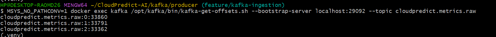
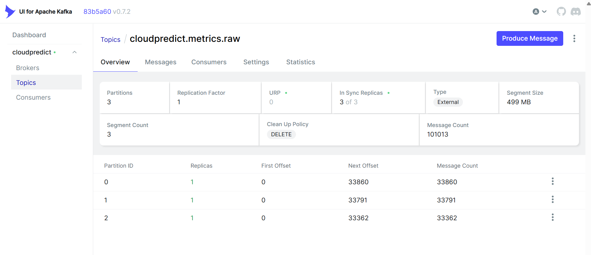
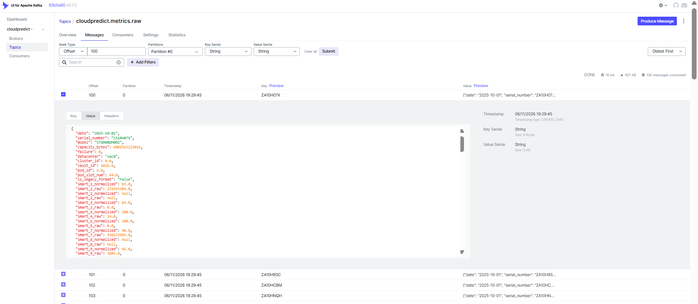
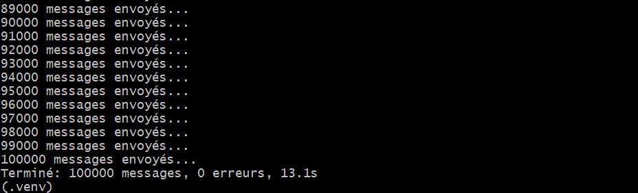

# Ingestion Kafka — CloudPredict AI

Cette partie reçoit les métriques SMART des disques durs (dataset Backblaze) et les publie en JSON dans Kafka. Elle constitue la couche d'ingestion de l'architecture.

## Configuration

| Élément | Valeur |
|---|---|
| Topic | `cloudpredict.metrics.raw` |
| Partitions | 3 |
| Clé des messages | `serial_number` |
| Depuis les conteneurs | `kafka:29092` |
| Depuis la machine hôte | `localhost:9092` |
| Kafka UI | http://localhost:8081 |

## Producteur Python

Le script `producer/producer.py` lit un fichier CSV ou ZIP Backblaze, convertit chaque ligne en événement JSON et l'envoie dans Kafka (bibliothèque `confluent-kafka`).

```bash
cd kafka/producer
python -m venv .venv
source .venv/Scripts/activate      # Windows (Git Bash)
pip install -r requirements.txt
python producer.py --file ../data/data_Q4_2025.zip --limit 1000
```

`--limit 0` envoie tout le fichier. Les données ne sont pas versionnées (`kafka/data/` est ignoré par Git).

## Tests

```bash
cd kafka
python -m pytest tests -v
```

Le test vérifie la conversion d'une ligne CSV en événement JSON.

## Résultats

Test avec le dataset Backblaze `data_Q4_2025.zip`, envois progressifs :

| Envoi | Messages | Erreurs |
|---|---|---|
| Échantillon CSV | 3 | 0 |
| Test | 10 | 0 |
| Montée en charge | 1 000 | 0 |
| Volume important | 100 000 | 0 (13,1 s, environ 7 600 msg/s) |

Offsets après tous les envois (total 101 013, aucun message perdu) :

```
cloudpredict.metrics.raw:0:33860
cloudpredict.metrics.raw:1:33791
cloudpredict.metrics.raw:2:33362
```

Les messages sont répartis de façon équilibrée sur les 3 partitions. Les premières lignes du fichier ont été renvoyées lors des tests successifs, elles apparaissent donc plusieurs fois dans le topic.

Vérification des offsets :

```bash
MSYS_NO_PATHCONV=1 docker exec kafka /opt/kafka/bin/kafka-get-offsets.sh --bootstrap-server localhost:29092 --topic cloudpredict.metrics.raw
```

## Captures




